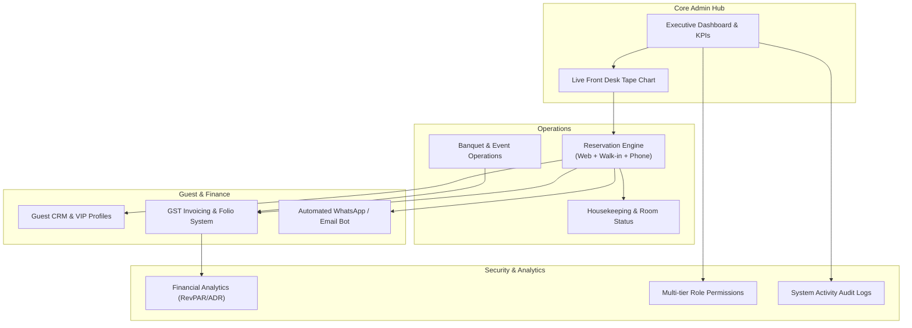
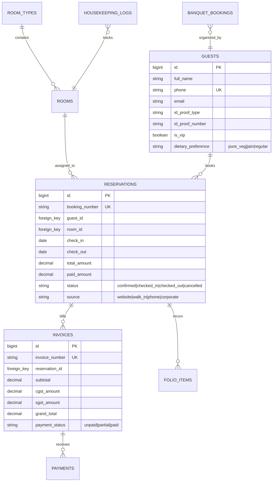
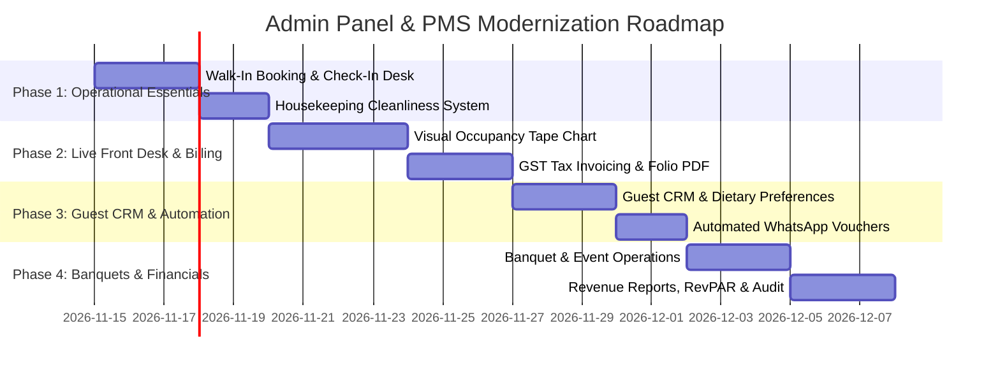

# 🏨 Hotel Rose Palace — Admin Panel & PMS Modernization Blueprint

> **Objective**: Elevate the Hotel Rose Palace Admin Panel from a basic content management system (CMS) into a comprehensive, enterprise-grade **Hotel Property Management System (PMS) & Revenue Operations Portal**. This blueprint equips management, front desk receptionists, and housekeeping staff with the tools needed to manage real-time room inventory, walk-in reservations, billing, guest communication, and financial reporting.

---

## 📋 Table of Contents
1. [Current State Analysis (CMS vs Full Hotel PMS)](#1-current-state-analysis-cms-vs-full-hotel-pms)
2. [Architectural Vision & System Pillars](#2-architectural-vision--system-pillars)
3. [Core Operational Modules to Add](#3-core-operational-modules-to-add)
   - [Module 1: Front Desk & Live Tape Chart (Visual Occupancy Grid)](#module-1-front-desk--live-tape-chart-visual-occupancy-grid)
   - [Module 2: Walk-In & Phone Reservation Engine](#module-2-walk-in--phone-reservation-engine)
   - [Module 3: Housekeeping & Room Cleanliness Management](#module-3-housekeeping--room-cleanliness-management)
   - [Module 4: Guest CRM & Lifetime Value Profiles](#module-4-guest-crm--lifetime-value-profiles)
   - [Module 5: GST Billing, Tax Invoices & Folio Management](#module-5-gst-billing-tax-invoices--folio-management)
   - [Module 6: Banquet & Corporate Event Booking Operations](#module-6-banquet--corporate-event-booking-operations)
   - [Module 7: Automated WhatsApp & Email Concierge Vouchers](#module-7-automated-whatsapp--email-concierge-vouchers)
   - [Module 8: Revenue Management, ADR, RevPAR & Analytics](#module-8-revenue-management-adr-revpar--analytics)
   - [Module 9: Role-Based Access Control (RBAC) & Audit Trail](#module-9-role-based-access-control-rbac--audit-trail)
4. [Admin UI/UX Redesign Blueprint](#4-admin-uiux-redesign-blueprint)
5. [Page-by-Page Modernization Guide](#5-page-by-page-modernization-guide)
6. [Database Schema Expansion Roadmap](#6-database-schema-expansion-roadmap)
7. [Phased Implementation Roadmap](#7-phased-implementation-roadmap)

---

## 1. Current State Analysis (CMS vs Full Hotel PMS)

Currently, the admin panel functions primarily as a static content editor with basic enquiry viewing:

| Operational Area | Current Capability | Missing in Current Admin | Impact on Operations |
| :--- | :--- | :--- | :--- |
| **Room Inventory** | Static list of rooms with `is_available` boolean toggle | No date-based occupancy calendar, no visual room matrix, no maintenance/cleaning states | Front desk cannot see which rooms are occupied tonight vs next week. |
| **Reservations** | Read-only list of website enquiries with status dropdown | Cannot create manual walk-in reservations, cannot assign room numbers, no check-in/out button | Staff must track bookings on paper registers or Excel sheets. |
| **Housekeeping** | Non-existent | No cleaning status (`Clean`, `Dirty`, `Inspected`, `Out of Order`), no staff assignment | Risk of checking guests into uncleaned or uninspected rooms. |
| **Billing & Folio** | None | No GST invoice generation (CGST/SGST 12%/18%), no payment logs (UPI, Cash, Card), no print receipts | Manual paper billing required, slowing down guest checkout. |
| **Guest CRM** | Raw enquiry table | No recurring guest history, no VIP tags, no preferences (Pure Veg / Jain dietary flags) | Lost repeat business and missed personalized hospitality opportunities. |
| **Banquets & Events** | None | No event hall booking calendar, no catering menu packages, no stage/AV checklist | Double-booking risks and uncoordinated banquet operations. |
| **Guest Messaging** | One-way public WhatsApp link | No admin-triggered WhatsApp confirmation vouchers, check-in reminders, or feedback requests | Manual typing of confirmation messages by front desk staff. |
| **Financial Reporting** | Simple counter widgets | No RevPAR, ADR, Occupancy %, Daily Collection Register, or monthly revenue charts | Management lacks visibility into profitability and seasonal demand. |

---

## 2. Architectural Vision & System Pillars

---

## 3. Core Operational Modules to Add

### Module 1: Front Desk & Live Tape Chart (Visual Occupancy Grid)
The heart of any modern hotel PMS is the **Visual Tape Chart / Room Matrix**:
- **Interactive Calendar Grid**:
  - **Y-Axis**: All hotel rooms grouped by floor and category (Room 201 - Deluxe, Room 301 - Executive Suite, etc.).
  - **X-Axis**: Days of the current week/month with day-of-week badges.
- **Color-Coded Reservation Blocks**:
  - 🟢 **Confirmed / Upcoming** (Green)
  - 🔵 **Checked In / Currently In-House** (Blue)
  - 🟡 **Pending Payment / Tentative** (Yellow)
  - 🔴 **Blocked / Out of Order for Maintenance** (Red)
- **Drag-and-Drop Room Reassignment**: Move a guest from Room 201 to 204 with automatic rate adjustment.
- **One-Click Quick Action**: Click any cell to view guest folio, execute instant check-in, or create a walk-in booking.

### Module 2: Walk-In & Phone Reservation Engine
Allow front desk receptionists to book rooms directly from the admin panel in under 60 seconds:
- **Fast-Booking Drawer / Modal**:
  - Select Check-in / Check-out dates.
  - Live available rooms dropdown (shows only clean, unoccupied rooms for selected dates).
  - Guest Search & Autofill (type mobile number to auto-fill returning guest profile).
  - Government ID capture (Aadhaar / Passport number + photo upload).
  - Tariff & Discount override (Corporate rate, Management discount, Complimentary upgrade).
  - Payment collection entry: Advance deposit amount + Payment Mode (Cash, GPay/PhonePe UPI, Card Swipe, Bill to Company).

### Module 3: Housekeeping & Room Cleanliness Management
Bridge the communication gap between front desk and housekeeping teams:
- **4-Stage Room Life Cycle**:
  1. `Dirty` (Auto-triggered upon guest check-out)
  2. `Cleaning in Progress` (Assigned to housekeeping attendant)
  3. `Clean & Ready for Inspection`
  4. `Inspected & Available for Check-in`
- **Mobile-Friendly Housekeeper View**: Housekeeping staff can log in on mobile devices to mark rooms as clean with one tap.
- **Maintenance Work Orders**: Report plumbing, AC, or TV issues with photo upload and urgent priority flags.

### Module 4: Guest CRM & Lifetime Value Profiles
Transform raw contacts into high-value relationships:
- **Comprehensive Guest Profiles**:
  - Total Stays, Total Nights, Total Lifetime Spend.
  - Identification documents stored securely (Aadhaar / Passport scans).
  - **Hospitality Tags**: `VIP`, `Corporate Delegate`, `Wedding Guest`, `Diamond Merchant`, `Blacklisted`.
  - **Special Preferences**: Pure Veg / Jain meal requirements, high-floor preference, extra towels, feather-free pillows.
  - Personal milestones: Birthday and Wedding Anniversary dates with automated congratulatory WhatsApp messages.

### Module 5: GST Billing, Tax Invoices & Folio Management
Full Indian GST compliance and seamless checkout accounting:
- **Automated Folio Generation**:
  - Room charges auto-posted daily at midnight (Night Audit).
  - Incidental charges: Room service, laundry, extra rollaway bed, airport taxi, restaurant dining.
- **Indian GST Tax Matrix**:
  - Room tariff `< ₹7,500`: 12% GST (6% CGST + 6% SGST)
  - Room tariff `≥ ₹7,500`: 18% GST (9% CGST + 9% SGST)
  - Food & Beverage: 5% GST
- **Printable Tax Invoices (PDF)**:
  - Formatted with Hotel Rose Palace branding, GSTIN, SAC codes (`996311` for room, `996331` for F&B), and QR code for UPI payment.
  - One-click "Send Invoice on WhatsApp / Email".

### Module 6: Banquet & Corporate Event Booking Operations
Surat is a prime corporate and wedding hub. Dedicated event operations will eliminate scheduling conflicts:
- **Banquet Booking Calendar**:
  - Track events by time slot: Morning Session (9 AM – 2 PM), Evening Reception (6 PM – 12 AM), Full Day.
  - Event details: Guest count, seating layout (Theatre, Floating, Cluster, U-Shape), catering menu selection.
  - Stage setup, sound system, projector, and decorator vendor coordination checklist.
  - Staged billing: Advance Token (25%), Pre-event Payment (50%), Final Settlement on event day.

### Module 7: Automated WhatsApp & Email Concierge Vouchers
Leverage the existing `WhatsAppService` to automate two-way guest operations directly from admin:
- **One-Click Pre-Built Message Templates**:
  - 📩 **Booking Confirmation Voucher**: Detailed summary with booking reference, dates, room type, Google Maps link, and payment status.
  - 🚗 **Pre-Arrival Reminder (24h before)**: "We look forward to welcoming you tomorrow! Need airport pickup?"
  - 🔑 **Digital Check-In Notification**: Room ready alert with Wi-Fi passwords and dining hours.
  - ⭐ **Post-Stay Google Review Request**: Sent 2 hours after checkout with a direct Google Review link.

### Module 8: Revenue Management, ADR, RevPAR & Analytics
Empower management with key hospitality performance metrics:
- **Core KPI Dashboard Cards**:
  - **Occupancy Rate (%)**: $\frac{\text{Rooms Sold}}{\text{Total Available Rooms}} \times 100$
  - **ADR (Average Daily Rate)**: $\frac{\text{Room Revenue}}{\text{Rooms Sold}}$
  - **RevPAR (Revenue Per Available Room)**: $\text{Occupancy Rate} \times \text{ADR}$
  - **Today's Expected Revenue vs Actual Collected Revenue**
- **Visual Trend Charts (Chart.js / ApexCharts)**:
  - 30-Day Revenue & Occupancy trajectory.
  - Channel Breakdown: Direct Website vs Phone / Walk-in vs Corporate vs Travel Agents.
  - Room Type Profitability Matrix: Which category drives the highest margin?

### Module 9: Role-Based Access Control (RBAC) & Audit Trail
Ensure security, accountability, and operational clarity across staff:
- **Role Permissions Hierarchy**:
  - 👑 **Super Admin / General Manager**: Full access to financial records, tariff changes, settings, and staff accounts.
  - 🛎️ **Front Desk Executive**: Check-in, check-out, bookings, room assignment, folio payments, guest lookup.
  - 🧹 **Housekeeping Supervisor**: View room clean states, update cleaning progress, log maintenance issues.
  - 📊 **Accountant / Night Auditor**: Access invoices, daily collection registers, and GST export reports.
- **Detailed System Audit Log**:
  - Every action recorded: *"User [Rajesh] changed Room 204 price from ₹3,999 to ₹3,500 on Nov 13, 11:45 AM"*.
  - Prevents revenue leakage and unaccounted cancellations.

---

## 4. Admin UI/UX Redesign Blueprint

### Executive Luxury Styling
- **Color Theme**: Maintain the signature **Champagne Sandstone & Burgundy Rose** palette with dark executive accents:
  - Sidebar: Deep Royal Burgundy (`#58222E`) with gold active indicators (`#B88A44`) and champagne text (`#F7F1E8`).
  - Content Canvas: Warm Sandstone (`#EDE4D8`) with clean elevated cards in `#F7F1E8` and subtle `#D8CBB8` borders.
  - Status Badges: Refined muted tones (Soft Green, Golden Amber, Burgundy Red, Sapphire Blue).

### Smart Operational UX Enhancements
1. **Global Quick Action Bar (Header)**:
   - Quick Search input (`/` shortcut): Instant lookup for guest name, phone number, room number, or reservation ID.
   - ⚡ **"Quick Check-In"** & ➕ **"New Walk-In Booking"** prominent header buttons.
   - Real-time notification bell with chime when a new website enquiry arrives.
2. **Keyboard Productivity Shortcuts**:
   - `Ctrl + K`: Global search.
   - `Alt + N`: Create new reservation.
   - `Alt + T`: Open Tape Chart calendar.
3. **Export & Print Ready**:
   - Every data table equipped with 1-click **Export to CSV/Excel** and **Print View**.

---

## 5. Page-by-Page Modernization Guide

### 📊 1. Dashboard (`/admin/dashboard`)
- [ ] Add 4 Core KPI cards: **Today's Occupancy %**, **In-House Guests Count**, **Today's Arrivals (Check-ins)**, and **Today's Departures (Check-outs)**.
- [ ] Revenue summary card showing Today's Revenue and Monthly MTD Revenue.
- [ ] Interactive 7-Day Mini Tape Chart widget directly on the dashboard.
- [ ] "Pending Enquiries Requiring Action" high-priority alert queue.
- [ ] Live Quick Action drawer for walk-in arrivals.

### 📅 2. Live Tape Chart & Calendar (`/admin/calendar`)
- [ ] Visual multi-day room matrix with drag-and-drop room reassignment.
- [ ] Filter by floor level or room type.
- [ ] Right-click context menu: *View Guest Details*, *Check-in*, *Mark Room Dirty*, *Block for Maintenance*.

### 🛎️ 3. Reservations & Enquiries (`/admin/enquiries` & `/admin/reservations`)
- [ ] Split into tabbed views: **All Bookings**, **Today's Arrivals**, **In-House Guests**, **Departures**, and **Cancellations**.
- [ ] Bulk actions: Confirm bookings, send bulk WhatsApp reminders, export to Excel.
- [ ] Guest Folio view with line-item breakdown of room tariff, meals, and add-ons.
- [ ] 1-Click WhatsApp buttons: Send Confirmation, Send Invoice, Send Welcome Note.

### 🛏️ 4. Rooms & Housekeeping (`/admin/rooms`)
- [ ] Toggle room availability and cleanliness status (`Clean`, `Dirty`, `Under Inspection`, `Out of Order`).
- [ ] Bulk status updater for housekeeping supervisors.
- [ ] Maintenance ticketing tab with photos and resolution status.
- [ ] Drag-and-drop image reordering and room featured image selector.

### 🧾 5. Billing & Invoices (`/admin/invoices`)
- [ ] Search invoices by Invoice Number, Guest Name, or Date Range.
- [ ] Generate standard Indian GST Tax Invoice with CGST/SGST separation.
- [ ] Print receipt formatted for standard thermal POS printers (80mm) or full A4 PDF invoices.
- [ ] Payment gateway transaction logs (Razorpay / UPI / Cash reconcile).

### 👥 6. Guest CRM (`/admin/guests`)
- [ ] Searchable directory of all past guests with total stays, phone, email, and ID proofs.
- [ ] VIP and Corporate Account tagging.
- [ ] Dietary preference tags (Pure Veg, Jain, Gluten-Free).
- [ ] Lifetime spend analytics per guest.

### 🎉 7. Banquets & Events (`/admin/banquets`)
- [ ] Visual Event Calendar with morning/evening booking slots.
- [ ] Banquet contract generator with catering menu checklist.
- [ ] Deposit and installment payment tracker.

### 📈 8. Reports & Analytics (`/admin/reports`)
- [ ] Daily Collection Register (Cash, UPI, Card, Bank).
- [ ] Monthly Revenue & Occupancy trends with Chart.js visualizations.
- [ ] Monthly GST Tax Filing Summary (GSTR-1 compatible CSV export).
- [ ] Managerial Daily Flash Report (Summary of arrivals, departures, room revenue, F&B revenue).

### ⚙️ 9. Settings & Audit Logs (`/admin/settings`)
- [ ] Hotel Profile: Logo, GSTIN, PAN, Bank Details, FSSAI License Number, Check-in/out policies.
- [ ] Seasonal & Weekend Dynamic Pricing rules.
- [ ] Staff User Management with Role-Based Permissions (`Admin`, `Reception`, `Housekeeping`, `Accounts`).
- [ ] Complete system activity audit trail.

---

## 6. Database Schema Expansion Roadmap

To support this transformation, the following database tables and columns will be added to the existing schema:

---

## 7. Phased Implementation Roadmap

### Immediate Quick Wins Recommended:
1. **Walk-In Reservation Creator**: Add a "New Reservation" modal directly on the admin dashboard so front desk staff can record phone and walk-in bookings.
2. **Housekeeping Status Pill on Rooms**: Add `Clean` / `Dirty` toggle to each room card.
3. **One-Click WhatsApp Voucher**: Add a "Send WhatsApp Voucher" button inside `/admin/enquiries/{id}`.
4. **GST Tax Invoice Generator**: Auto-generate a clean, printable PDF invoice with hotel GSTIN for completed stays.

---
*Document prepared for Hotel Rose Palace management & development roadmap.*
