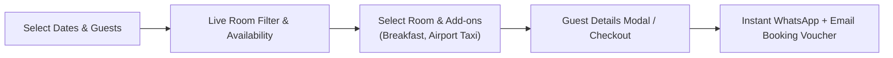
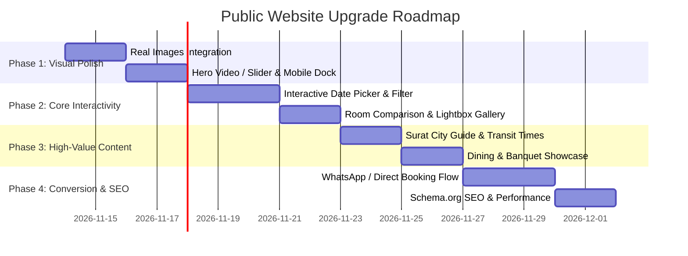

# 🏨 Hotel Rose Palace — Public Website Modernization & Redesign Blueprint

> **Objective**: Elevate the public-facing website of Hotel Rose Palace from a basic brochure website into a world-class, high-converting luxury hotel portal that captivates guests, drives direct bookings, and reflects the true heritage and sophistication of the property in Surat.

---

## 📋 Table of Contents
1. [Current State Analysis (Why It Looks "Too Simple")](#1-current-state-analysis-why-it-looks-too-simple)
2. [Design & Visual Aesthetic Overhaul (Luxury Hospitality Feel)](#2-design--visual-aesthetic-overhaul-luxury-hospitality-feel)
3. [Booking & Reservation Engine (The Critical Missing Layer)](#3-booking--reservation-engine-the-critical-missing-layer)
4. [New High-Value Sections to Transform the Public Experience](#4-new-high-value-sections-to-transform-the-public-experience)
5. [Page-by-Page Transformation Blueprint](#5-page-by-page-transformation-blueprint)
6. [Interactive Micro-Interactions & Guest Experience Features](#6-interactive-micro-interactions--guest-experience-features)
7. [Technical & Code Clean-Up Recommendations](#7-technical--code-clean-up-recommendations)
8. [Phased Implementation Roadmap](#8-phased-implementation-roadmap)

---

## 1. Current State Analysis (Why It Looks "Too Simple")

While the existing website has clean fonts and a warm color palette, it currently suffers from several common design and functional limitations:

| Current Issue | What's Missing | Why It Impacts the User |
| :--- | :--- | :--- |
| **Static Hero Banner** | A static photo with a heavy 50% dark tint overlay | Lacks the emotional "wow" factor expected from modern luxury hotels (video/animated sliders). |
| **Cosmetic "Check Availability" Bar** | Picking dates does not query room inventory; it only redirects via `window.location.href='/rooms'` | Frustrates visitors who expect real date checks, pricing calculations, and instant booking. |
| **Heavy Inline CSS** | Blade templates have hundreds of inline `style="..."` attributes | Makes layout adjustments brittle, limits responsiveness on tablets/mobiles, and creates visual inconsistency. |
| **Generic Stock Imagery** | Uses placeholder Unsplash photos instead of real property assets | Reduces trust and credibility; guests want to see the real rooms, lobby, and bathrooms. |
| **Flat Brochure Structure** | Information is displayed in standard Bootstrap cards with minimal interactivity | No room comparison, no 360° virtual tours, no interactive menus, and no event capacity calculators. |
| **Missing Real Social Proof** | Static hardcoded testimonials with foreign names | Lacks authentic Google Reviews / TripAdvisor integration and verified guest photos. |
| **No Dynamic Mobile Dock** | Mobile users must scroll up to reach navigation or calls to action | Over 70% of hotel bookings and inquiries happen on mobile; a sticky bottom bar is essential. |

---

## 2. Design & Visual Aesthetic Overhaul (Luxury Hospitality Feel)

To match 5-star hospitality standards (like *Oberoi, Taj, Rosewood, and ITC*), the visual architecture should be upgraded with the following principles:

### A. Dynamic Cinematic Hero Section
- **Ambient Video / Ken Burns Slideshow**:
  - Replace the single static image with a subtle looping ambient video reel (exterior drone shot, lobby arrival, suite interior, evening lighting).
  - Alternative: High-resolution full-width photo slider featuring real hotel photos with a subtle Ken Burns zoom effect and gold pagination bullets.
- **Glassmorphic Floating Reservation Engine**:
  - A frosted-glass (`backdrop-filter: blur(16px)`) horizontal search bar overlapping the hero banner.
  - Interactive inputs: **Check-in**, **Check-out**, **Rooms & Guests Dropdown**, and a prominent **"Check Rates & Availability"** button with a gold hover glow.

### B. Refined Editorial Luxury Typography & Color Hierarchy
- **Typography Pairing**:
  - Headings: *Cormorant Garamond* or *Playfair Display* with italicized accent words (e.g., *"Where Elegance Meets Comfort"*).
  - Subheadings & Eyebrows: *Plus Jakarta Sans* or *Inter* with `letter-spacing: 3px; text-transform: uppercase`.
- **Color Palette Upgrade**:
  - Primary Background: Warm Alabaster (`#FAF7F2`) and Sandstone (`#F4EFE6`).
  - Brand Accent: Deep Royal Burgundy (`#5B1D2B`) and Champagne Gold (`#C5A059` / `#D4AF37`).
  - Text: Charcoal Black (`#1F1A1C`) for high contrast readability and Warm Taupe (`#706668`) for subtext.

### C. Layered Depth, Curves & Asymmetry
- Replace rigid rectangular cards with:
  - Arch-shaped photo frames (Mughal/Rajputana architectural arch motif) to reflect the "Palace" heritage.
  - Asymmetric editorial grids (pairing a large feature image with a 2-photo vertical stack and gold outline badges).
  - Subtle gold hairline dividers (`border-image: linear-gradient(to right, transparent, #C5A059, transparent) 1`).

---

## 3. Booking & Reservation Engine (The Critical Missing Layer)

Currently, the public site is an informational brochure. Upgrading it with a real guest booking workflow will significantly increase direct bookings:



### Key Functional Upgrades:
1. **Interactive Date Range Picker**:
   - Integrated with Flatpickr or Litepicker.
   - Displays real-time blocked dates, minimum stay rules, and dynamic price badges on the calendar.
2. **Interactive Guest & Room Selector Dropdown**:
   - Incremental counter (`+` / `-`) for Adults, Children (with age tags), and Number of Rooms.
3. **Live Price Breakdown Calculator**:
   - Displays:
     - `Base Rate × Number of Nights`
     - `Extra Guest Charge` (if applicable)
     - `Add-ons (e.g., Airport Pickup +₹600, Candlelight Dinner +₹1,999)`
     - `GST Breakdown (12% / 18%)`
     - **Total Payable** with a "Best Rate Guaranteed" badge.
4. **Direct Booking / Instant Inquiry Channel**:
   - Option A: **Seamless WhatsApp Booking**: Generates a pre-filled, formatted WhatsApp message with booking reference, room type, dates, and total price sent directly to the hotel reception.
   - Option B: **Direct Online Reservation**: Step-by-step guest modal collecting name, phone, email, and ID proof with options: *"Pay at Hotel"* or *"Pay Online via UPI / Card / Razorpay"*.

---

## 4. New High-Value Sections to Transform the Public Experience

### 1. Interactive Room Comparison Matrix
Allow guests to compare room types side-by-side instead of navigating back and forth:
- **Columns**: Deluxe Double | Superior Twin | Executive Suite | Presidential Suite.
- **Rows**:
  - Room Area (sq. ft.)
  - Bedding Type (King / Twin)
  - View (City View / Garden / Skyline)
  - Complimentary Breakfast (Included / Optional)
  - Bathroom Features (Marble en-suite, rain shower, bathtub)
  - Occupancy (2 Adults / 2 Adults + 1 Child / Family)
  - Starting Rate & Direct "Book Now" CTA

### 2. Surat Destination & Location Guide (Business & Leisure)
Surat is India's diamond and textile capital. Business travelers and tourists prioritize connectivity:
- **Transit Time & Distance Cards**:
  - ✈️ **Surat International Airport**: 12 mins (8.5 km)
  - 💎 **Surat Diamond Bourse (Khajod)**: 15 mins (11 km)
  - 🛍️ **Textile Market Ring Road**: 18 mins (10 km)
  - 🏖️ **Dumas Beach**: 20 mins (14 km)
  - 🏬 **VR Surat Mall & Multiplex**: 5 mins (2.2 km)
- **Interactive Map Filter**: Toggle between "Shopping", "Corporate Hubs", "Transport", and "Tourist Attractions" with direct "Open in Google Maps" navigation links.

### 3. Dining, Restaurant & In-Room Service Showcase
Food and dining drive high hospitality satisfaction:
- **Interactive Food Menu Tabs**:
  - *Breakfast Buffet* | *Authentic Gujarati Thali* | *North Indian & Continental* | *Beverages & Mocktails*.
- High-res food photography with dietary indicators (🟢 100% Pure Veg options, Jain food available upon request).
- **"Reserve a Table" or "Download Food Menu (PDF)" CTA**.

### 4. Banquet, Conferences & Wedding Celebrations
Banquet halls are a major revenue generator for Surat hotels:
- **Event Space Capacity Matrix**:
  - Layout types: *Floating Reception (250+)*, *Theatre Style (150)*, *Cluster Dining (100)*, *Boardroom (35)*.
- **Interactive Banquet Quote Estimator**:
  - Guests select: Event Date, Event Type (Wedding, Birthday, Corporate Meeting, Exhibition), and Expected Guests -> Instant WhatsApp quote request.

### 5. Authentic Social Proof & Trust Badges
- **Live Google Reviews Widget**:
  - Aggregate rating badge: ⭐ **4.8 / 5.0** based on 450+ verified guest reviews.
  - Verified guest reviews with traveler category tags: *Business Traveler*, *Family Vacation*, *Couple Stay*.
- **Hotel Trust & Safety Badges**:
  - 🛡️ Sanitized & Certified Rooms
  - 🚗 Free Valet & High-Security Parking
  - 📶 High-Speed 500 Mbps Wi-Fi
  - 🕒 24/7 Front Desk & Concierge
  - 💳 Flexible 24-Hour Free Cancellation

### 6. Interactive FAQ Accordion
A collapsible FAQ section answering top guest queries:
- What are the standard check-in and check-out timings? (Early check-in policy)
- What identity documents are required at check-in?
- Do you provide airport pickup and drop-off?
- Is parking available on-site, and is it free?
- What are the cancellation and refund policies?

---

## 5. Page-by-Page Transformation Blueprint

### 🏠 Home Page (`/`)
- [ ] Replace static hero with high-definition video reel or auto-sliding luxury carousel.
- [ ] Floating responsive availability search engine with real date picking.
- [ ] "The Rose Palace Experience" narrative section with architectural arch image frames and gold badge.
- [ ] Featured Rooms grid with interactive amenity icons, price per night, and "Quick View" modal.
- [ ] Curated Experiences section (Corporate Stays, Weekend Getaways, Wedding Packages) with interactive hover cards.
- [ ] Virtual 360° tour preview or interactive video walkthrough button.
- [ ] Live Google Reviews carousel with verified guest badges.
- [ ] Location connectivity matrix (Airport, Diamond Bourse, Textile Market).
- [ ] Instagram live feed gallery (`#HotelRosePalaceSurat`).

### 🛏️ Rooms & Suites Listing (`/rooms`)
- [ ] Filter pills with live client-side sorting: *All Rooms*, *Deluxe*, *Suites*, *Family Rooms*, *Business Class*.
- [ ] Price sort dropdown (Low to High / High to Low).
- [ ] Room cards with photo carousel (3-5 photos per room instead of just 1).
- [ ] "Compare Rooms" drawer button.
- [ ] Prominent inclusions checklist: Free Wi-Fi, Breakfast, Free Cancellation.
- [ ] Direct "Book on WhatsApp" and "Reserve Online" buttons.

### 🔍 Room Detail Page (`/rooms/{slug}`)
- [ ] Hero full-width image gallery with lightbox and thumbnail carousel (like Airbnb/Booking.com).
- [ ] Sticky sidebar booking card: As the user scrolls through room descriptions and amenities, the booking form remains pinned on the right.
- [ ] Comprehensive room specifications: Floor level, square footage, bed dimensions, view, bathroom amenities.
- [ ] 3D Room Floor Plan or interactive layout diagram.
- [ ] "Similar Rooms You Might Like" recommendation slider at the bottom.

### ℹ️ About Us (`/about`)
- [ ] "Our Heritage & Vision" visual timeline of Hotel Rose Palace.
- [ ] Meet the Hospitality Team / General Manager's Welcome note.
- [ ] Sustainability and hygiene commitments.
- [ ] Virtual tour of the lobby, lounge, and facilities.

### 🏊 Amenities Page (`/amenities`)
- [ ] Category tabs: *Wellness & Fitness*, *Business & Work*, *Dining & Banquets*, *Guest Convenience*.
- [ ] Real photos for each facility instead of just FontAwesome icons.
- [ ] Timings and access policies (e.g., Gym: 6:00 AM – 10:00 PM, Dining: 7:00 AM – 11:00 PM).

### 🖼️ Gallery (`/gallery`)
- [ ] Category filter tabs: *All*, *Rooms & Suites*, *Lobby & Architecture*, *Dining*, *Events & Banquets*.
- [ ] Fullscreen lightbox with zoom and keyboard navigation (arrow keys).
- [ ] Lazy loading with smooth blur-up placeholders.

### 📞 Contact Page (`/contact`)
- [ ] Direct one-tap contact buttons: Call Reception, Call Reservations, WhatsApp Chat, Email Concierge.
- [ ] Interactive Google Maps with custom dark/gold luxury map styling.
- [ ] Interactive Contact & Enquiry Form with instant validation and rate-limiting.
- [ ] Airport shuttle request form.

---

## 6. Interactive Micro-Interactions & Guest Experience Features

1. **Floating Mobile Action Dock**:
   - On screens `< 768px`, show a persistent bottom navigation bar:
     - 📞 **Call** (`tel:...`)
     - 💬 **WhatsApp** (pre-filled chat)
     - 📍 **Directions** (Google Maps)
     - 🏷️ **Book Now** (opens quick date picker modal)
2. **Special Offer Banner / Top Announcement Strip**:
   - Sleek top marquee: *"Book directly on our website & enjoy 10% off on dining + complimentary early check-in. Use code: **ROSEDIRECT**"*.
3. **Currency Switcher**:
   - Toggle between **INR (₹)** and **USD ($)** for international visitors and business delegates.
4. **Smooth Scroll & Micro-Animations**:
   - AOS (Animate on Scroll) or GSAP triggers for smooth fade-up transitions on headers and cards.
   - Elegant hover zoom on images (`scale: 1.05; transition: 0.5s ease`).

---

## 7. Technical & Code Clean-Up Recommendations

1. **Eliminate Inline Styles**:
   - Transition from inline `style="padding: 60px 0; background: ..."` to Tailwind CSS classes or custom SCSS utility classes (`.hrp-section`, `.hrp-card`, `.hrp-gold-btn`).
   - Keeps blade files clean, readable, and easy to maintain.
2. **Optimize Images & Assets**:
   - Convert catalog photos in `public/images/` to modern `.webp` format.
   - Implement `srcset` for high-DPI displays (retina screens) and responsive mobile sizes.
   - Use `loading="lazy"` on all images below the fold to achieve 90+ Google PageSpeed score.
3. **Structured Data & SEO (Schema.org)**:
   - Add JSON-LD schema markup for `Hotel`, `LodgingBusiness`, and `FAQPage`:
     ```html
     <script type="application/ld+json">
     {
       "@context": "https://schema.org",
       "@type": "Hotel",
       "name": "Hotel Rose Palace",
       "address": {
         "@type": "PostalAddress",
         "streetAddress": "Atlanta Business Hub, VIP Road, Vesu",
         "addressLocality": "Surat",
         "addressRegion": "Gujarat",
         "postalCode": "395007",
         "addressCountry": "IN"
       },
       "priceRange": "₹3,499 - ₹8,999",
       "starRating": { "@type": "Rating", "ratingValue": "4.5" }
     }
     </script>
     ```
4. **Open Graph & Social Sharing Cards**:
   - Proper `og:image`, `og:title`, and `og:description` tags so links shared on WhatsApp, Facebook, and LinkedIn display a rich luxury hotel preview card.

---

## 8. Phased Implementation Roadmap



### Next Steps:
1. Review this proposal and select which priority features you would like implemented first (e.g., the **Cinematic Hero + Mobile Dock**, the **Real Date/Room Booking Flow**, or the **Room Comparison Matrix**).
2. Begin replacing placeholder Unsplash photos with the organized photos from `public/images/`.
3. Enhance the Blade views step-by-step while maintaining full compatibility with the existing Admin Panel and database.

---
*Document prepared for Hotel Rose Palace repository enhancement.*
